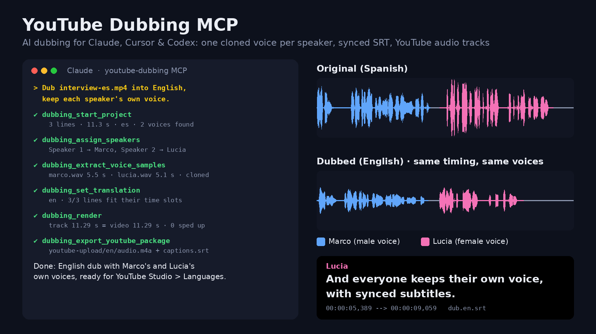
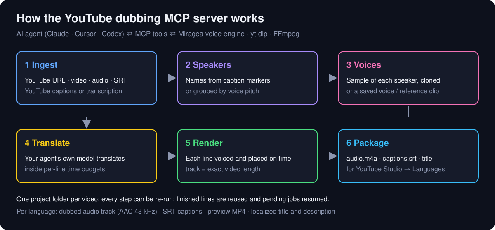

# YouTube Dubbing MCP: AI dubbing with one cloned voice per speaker

[](https://github.com/RTY2345RR/youtube-dubbing-mcp/actions/workflows/ci.yml)
[](https://hub.docker.com/r/miragea/youtube-dubbing-mcp)
[](https://registry.modelcontextprotocol.io/v0/servers?search=youtube-dubbing-mcp)
[](pyproject.toml)
[](LICENSE)
[](https://huggingface.co/spaces/miragea/youtube-dubbing-mcp)

**YouTube Dubbing MCP is an open-source MCP server that lets an AI agent (Claude, Cursor, Codex, VS Code) dub a YouTube video, a local video or an SRT file into another language, giving every speaker their own cloned voice, with synced SRT captions and upload-ready YouTube multi-language audio tracks.** You ask *"dub this video into English and keep each speaker's voice"*; the agent translates, and the server does everything that touches audio: transcript, speaker detection, voice samples, voicing, timing, mixing and packaging.



▶ **Listen to the real output:** [English dub (MP3)](examples/spanish-to-english-two-speakers/dub.en.mp3) · [dubbed video (MP4)](examples/spanish-to-english-two-speakers/dubbed-interview-en.mp4) · [original Spanish video](examples/spanish-to-english-two-speakers/source-interview-es.mp4) · [synced SRT](examples/spanish-to-english-two-speakers/dub.en.speakers.srt) · or play them in the browser on the [Hugging Face demo page](https://huggingface.co/spaces/miragea/youtube-dubbing-mcp).

<!-- mcp-name: io.github.RTY2345RR/youtube-dubbing-mcp -->

## Contents
- [Why this AI dubbing MCP server](#why-this-ai-dubbing-mcp-server)
- [How YouTube dubbing works here](#how-youtube-dubbing-works-here)
- [Quick start](#quick-start)
- [Example: dub a YouTube video to English with two voices](#example-dub-a-youtube-video-to-english-with-two-voices)
- [Tools](#tools)
- [Upload multi-language audio tracks to YouTube](#upload-multi-language-audio-tracks-to-youtube)
- [Comparison with other AI dubbing tools](#comparison-with-other-ai-dubbing-tools)
- [FAQ](#faq)
- [Troubleshooting](#troubleshooting)

## Why this AI dubbing MCP server
- **Multi-speaker dubbing, each voice cloned.** Speakers come from caption markers (`Name:`, `[Name]`, `>>`) or, when there are none, from voice pitch. `dubbing_extract_voice_samples` cuts a clean sample of every speaker from the video itself, so Anna still sounds like Anna in Spanish, German or English.
- **Dub YouTube videos from a URL.** Reads YouTube's manual or automatic captions when they exist (fast, free of guesswork), otherwise transcribes the audio. Local MP4/MOV/MKV/MP3/WAV files and existing SRT/VTT subtitles work too.
- **Timing that fits.** Each line gets a character budget for its time slot in the target language, the agent writes to it, and the renderer starts every line with the original and only speeds up (pitch kept, capped at 1.25×) when it must. The dub track is exactly as long as the video, which YouTube requires.
- **Upload-ready for YouTube.** One folder per language with `audio.m4a` (AAC 48 kHz), `captions.srt`, a localized title and description, and the YouTube Studio steps.
- **Resumable and safe.** Everything is saved in a project folder. Re-running a tool reuses finished lines, resumes pending jobs and never submits the same line twice. The API key never appears in output or logs.
- **No GPU, no local models.** One `uvx` command or one Docker image; ffmpeg comes bundled. Voices are rendered by the [Miragea](https://miragea.ai) voice engine.

## How YouTube dubbing works here



1. **Ingest:** YouTube URL → audio + captions (yt-dlp), or a local video/audio/SRT file. Caption fragments are merged into sentences; speech without captions is transcribed and re-split at pauses.
2. **Speakers:** names from caption markers, or grouped by voice pitch. Fix anything with one call.
3. **Voices:** a sample of each speaker is cut from the source and cloned, or you pick a saved voice / any public reference clip.
4. **Translate:** your agent's own model translates, line by line, inside the time budget. Too-long lines are reported back for shortening.
5. **Render:** every line is voiced in its speaker's voice, placed at its original start time, and mixed into a track of the exact video length, with an SRT and an optional preview MP4.
6. **Package:** per-language folders for YouTube Studio → Languages.

## Quick start

1. Install [uv](https://docs.astral.sh/uv/) (it provides `uvx`).
2. Get a voice engine API key at [miragea.ai/workspace/api](https://miragea.ai/workspace/api).
3. Add the server to your MCP client:

**Claude Code**
```bash
claude mcp add youtube-dubbing -s user -e MIRAGEA_API_KEY=<your-key> -- uvx --from git+https://github.com/RTY2345RR/youtube-dubbing-mcp youtube-dubbing-mcp
```

**Claude Desktop / Cursor / Windsurf** (`claude_desktop_config.json`, `~/.cursor/mcp.json`)
```json
{
  "mcpServers": {
    "youtube-dubbing": {
      "command": "uvx",
      "args": ["--from", "git+https://github.com/RTY2345RR/youtube-dubbing-mcp", "youtube-dubbing-mcp"],
      "env": { "MIRAGEA_API_KEY": "<your-key>" }
    }
  }
}
```

**Codex** (`~/.codex/config.toml`)
```toml
[mcp_servers.youtube-dubbing]
command = "uvx"
args = ["--from", "git+https://github.com/RTY2345RR/youtube-dubbing-mcp", "youtube-dubbing-mcp"]
tool_timeout_sec = 1800
env = { MIRAGEA_API_KEY = "<your-key>" }
```

**VS Code** (`.vscode/mcp.json`): run `uvx --from git+https://github.com/RTY2345RR/youtube-dubbing-mcp youtube-dubbing-mcp --print-config vscode` and paste the output.

**Docker**: `docker run -i --rm -e MIRAGEA_API_KEY -v $HOME/YouTubeDubbing:/data miragea/youtube-dubbing-mcp` ([Docker Hub](https://hub.docker.com/r/miragea/youtube-dubbing-mcp)).

Check everything with `uvx --from git+https://github.com/RTY2345RR/youtube-dubbing-mcp youtube-dubbing-mcp --check` (creates no job). `uvx` installs it straight from this repository in one command; a PyPI release (`uvx youtube-dubbing-mcp`) is on the way.

| Variable | Default | Purpose |
| --- | --- | --- |
| `MIRAGEA_API_KEY` | required for voicing and transcription | voice engine key |
| `DUBBING_OUTPUT_DIR` | `~/YouTubeDubbing` | where projects are saved |
| `DUBBING_CONCURRENCY` | `4` | lines voiced in parallel |
| `MIRAGEA_WAIT_TIMEOUT` | `900` | seconds to wait per job before returning (re-run to resume) |
| `YTDLP_COOKIES_FROM_BROWSER` / `YTDLP_COOKIES` | unset | browser name or cookies.txt when YouTube asks to sign in |
| `FFMPEG_BINARY` | system or bundled ffmpeg | custom ffmpeg |

## Example: dub a YouTube video to English with two voices

Prompt used for the demo in [`examples/spanish-to-english-two-speakers`](examples/spanish-to-english-two-speakers):

> Dub `interview-es.mp4` into English. Marco and Lucia should keep their own voices. Then make the YouTube upload package.

What the agent called, with the real results:

| Step | Tool call | Result |
| --- | --- | --- |
| 1 | `dubbing_start_project(source="interview-es.mp4", source_language="es")` | 3 sentences, 11.3 s, 2 voices found by pitch (117 Hz / 182 Hz) |
| 2 | `dubbing_assign_speakers({"1-2": "Marco", "3": "Lucia"})` | speakers named |
| 3 | `dubbing_extract_voice_samples(share=true)` | 5.5 s and 5.1 s samples, both voices set |
| 4 | `dubbing_set_translation("en", {...}, title=...)` | 3/3 lines fit their slots |
| 5 | `dubbing_render("en")` | track 11.29 s = video 11.29 s, 0 lines sped up |
| 6 | `dubbing_export_youtube_package()` | `youtube-upload/en/audio.m4a`, `captions.srt`, `title.txt` |

The English dub ([MP3](examples/spanish-to-english-two-speakers/dub.en.mp3), [SRT](examples/spanish-to-english-two-speakers/dub.en.speakers.srt)):

```srt
1
00:00:00,000 --> 00:00:00,991
[Marco] Hi everyone.

2
00:00:01,187 --> 00:00:04,815
[Marco] Today we're dubbing this video into another language in one step.

3
00:00:05,389 --> 00:00:09,059
[Lucia] And everyone keeps their own voice, with synced subtitles.
```

A speech-recognition pass over the finished English track reads back *"Hi everyone! Today we're dubbing this video into another language in one step, and everyone keeps their own voice with synced subtitles."* The male and female voices keep their pitch (about 110 Hz and 170 Hz), so each speaker stays recognisable.

## Tools

| Tool | What it does |
| --- | --- |
| `dubbing_check_setup` | Key set (hidden), voice engine reachable, models and limits, ffmpeg and yt-dlp found. Read-only. |
| `dubbing_start_project` | YouTube URL / video / audio / SRT → project with sentences and speakers (`num_speakers` optional). |
| `dubbing_get_segments` | Pages of lines with speaker and timing; with `target_language`, `target_chars` and `max_chars` per line. |
| `dubbing_assign_speakers` | `{"1-4": "Anna", "5": "Ben", "*": "Host"}`. |
| `dubbing_extract_voice_samples` | Clean 4–14 s sample per speaker + transcript; `share=true` clones them automatically. |
| `dubbing_set_voice` | Saved voice (`actor_id`) or any public `reference_audio_url` + `reference_text`; model and speed. |
| `dubbing_list_voices` | Saved voices in your voice engine account. |
| `dubbing_set_translation` | Save `{id: line}` + localized title/description; returns lines that are too long. |
| `dubbing_render` | Voice all lines, fit them to the timeline, write the track (m4a/mp3/wav), SRT and preview MP4; optional background music. |
| `dubbing_export_youtube_package` | Per-language upload folders + `UPLOAD-TO-YOUTUBE.md` + Studio link. |
| `dubbing_project_status` / `dubbing_list_projects` | Where everything is. |

## Upload multi-language audio tracks to YouTube

YouTube's public Data API **cannot** upload additional audio tracks, so no tool can do the final click for you. The package makes it a one-minute job per language in YouTube Studio:

1. **Studio → Content → your video → Languages.**
2. **Add language → Dub → Add** → upload `audio.m4a` → **Publish**.
3. **Subtitles → Add → Upload file → With timing** → `captions.srt`.
4. **Title & description → Add** → paste `title.txt` / `description.txt`.

Viewers then choose the track under **Settings → Audio track**. Multi-language audio is available to channels YouTube has enabled for the feature.

## Comparison with other AI dubbing tools

| | **youtube-dubbing-mcp** | elevenlabs-mcp | AllVoiceLab-MCP | Auto-Synced-Translated-Dubs | YouTube auto-dubbing |
| --- | --- | --- | --- | --- | --- |
| Works from an AI agent (MCP) | ✅ | ✅ | ✅ | ❌ (Python scripts) | ❌ |
| Dedicated dubbing tool / workflow | ✅ 12 tools | ❌ (TTS, STT, cloning; no dubbing tool) | ✅ one tool | ✅ | ✅ |
| One cloned voice per speaker | ✅ automatic from the video | manual | ❌ | ❌ stock voices | ❌ |
| Input: YouTube URL | ✅ | ❌ | ❌ | ❌ (needs an SRT) | ✅ (own channel) |
| Agent can edit translation before voicing | ✅ with per-line time budgets | — | ❌ | ✅ (manual) | ❌ |
| Track length = video, SRT, upload package | ✅ | ❌ | partial | ✅ | built-in |
| Resume without duplicate jobs | ✅ | ❌ | ❌ | ❌ | — |
| Licence | MIT | MIT | MIT | AGPL-3.0 | proprietary |

Feature status of other projects as read from their repositories and docs in November 2026; corrections welcome.

## FAQ

**How do I dub a YouTube video into English with AI?**
Add this server to Claude, Cursor or Codex and ask: *"Dub https://youtu.be/… into English, keep each speaker's voice, then make the YouTube upload package."* The agent runs the six steps above and you get an English audio track, SRT and upload folder.

**Can AI dubbing keep the original speaker's voice?**
Yes. `dubbing_extract_voice_samples` cuts a few seconds of each speaker from the original audio and the voice engine clones it, so every speaker is dubbed in their own voice. Ask the people in the video before cloning their voices.

**Can I upload multiple audio tracks to YouTube with the API?**
No. The YouTube Data API has no endpoint for extra audio tracks, so tracks are added in YouTube Studio → Languages. This server prepares the exact files and steps.

**Is there an open-source AI video dubbing tool for multiple speakers?**
This project is MIT-licensed and handles any number of speakers, each with a separate voice. The voices are rendered by a hosted voice engine, so no GPU is needed.

**Can I dub from an SRT file instead of a video?**
Yes: `dubbing_start_project(source="talk.srt")`. Without source audio, choose voices with `dubbing_set_voice`.

**Is this an ElevenLabs dubbing alternative?**
It is an open-source dubbing workflow for AI agents with per-speaker voice cloning, editable translations and YouTube packaging. The voices come from the Miragea voice engine.

**Which languages are supported?**
Any language your agent can translate into and the voice engine can speak. The demo is Spanish → English; per-language speaking rates are built in for 35+ languages so lines fit their slots.

**Does it work offline or need a GPU?**
It needs internet for the voice engine and YouTube, and no GPU.

## Troubleshooting

| Problem | Fix |
| --- | --- |
| `Sign in to confirm you're not a bot` | Set `YTDLP_COOKIES_FROM_BROWSER=chrome` (or `firefox`, `edge`, `safari`) in the server env, or download the video and pass the file. |
| `MIRAGEA_API_KEY is not set` | Add it to the server's `env` block and restart the client. Never paste keys into chat. |
| Some lines report `overflowing_lines` | Shorten those ids with `dubbing_set_translation` and render again; unchanged lines are reused. |
| Two people were put under one speaker | `dubbing_assign_speakers` with ids or ranges, or start again with `num_speakers`. |
| A tool timed out | Call it again; saved task ids are resumed, nothing is submitted twice. |
| Voice sample upload blocked by your network | Host `samples/<speaker>.wav` at any public https URL and use `dubbing_set_voice`. |
| ffmpeg not found | It is bundled; set `FFMPEG_BINARY` to use another one. |

## Related projects
- [TTS MCP Server](https://github.com/RTY2345RR/miragea-voice-mcp): text-to-speech, voiceover and SRT/VTT captions for AI agents.
- [Voice Agent Skills](https://github.com/RTY2345RR/miragea-agent-skills): Agent Skills for voiceover and dubbing workflows in Claude Code and Codex.
- [Live demo page](https://huggingface.co/spaces/miragea/youtube-dubbing-mcp) with audio players.

## Credits
Voices and transcription by the [Miragea](https://miragea.ai) voice engine (`https://miragea.ai/v1`). Agents that support skills can also install its audio skill with: `Install https://miragea.ai/skills/miragea-audio/install.md`. YouTube access by [yt-dlp](https://github.com/yt-dlp/yt-dlp); audio by [FFmpeg](https://ffmpeg.org).

MIT License.
